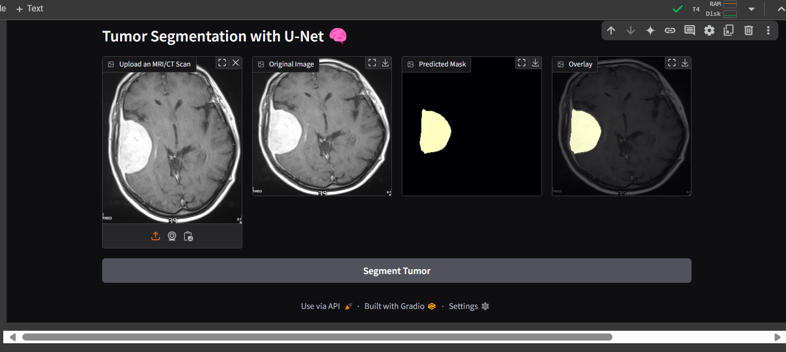

# Brain Tumor Segmentation with Deep Learning

**Binary tumor-region segmentation in brain scan images using a compact U-Net, DeepLabV3+ (MobileNetV2), and ResNet50 U-Net.**



> **Research prototype — not for clinical use.** Predictions are not diagnoses. The screenshot above is a **historical demonstration from the supplied project**, not proof of clinical accuracy. The source image and MRI dataset permissions must be confirmed before redistribution.

## Overview

This project began as a Google Colab image-segmentation experiment. It uses **polygon-annotated 2D brain scan images** to train models that produce a pixel-level binary tumor mask. The original notebook explored:

| Model | Approach | Included here |
|---|---|---|
| **Compact U-Net** | Encoder–decoder CNN with skip connections | Modular implementation; saved **historical** U-Net `.h5` checkpoint |
| **DeepLabV3+** | Atrous Spatial Pyramid Pooling with a MobileNetV2 encoder | Corrected feature-resolution handling; optional ImageNet weights |
| **ResNet50 U-Net** | Frozen ResNet50 encoder, U-Net-style decoder | Correct model-selection and model-saving logic |

The new repository focuses on **reproducible engineering and honest evaluation**: lossless PNG masks, explicit dataset checks, saved split assignments, native `.keras` checkpoints, separate held-out test evaluation, Dice and IoU, an optional subject-level split, and a local-only Gradio demo.

### Project capabilities

- Recreate pixel masks from VIA-style polygon annotation JSON.
- Train **any of the three architectures** from a command line or the provided notebook.
- Calculate Dice, IoU, and pixel accuracy on held-out labels; report tumor-positive-only Dice/IoU.
- Load the original supplied U-Net checkpoint for a research-only segmentation demo.
- Save predictions as transparent, readable **binary mask** and **RGB overlay** files.
- Run automated unit tests without downloading medical images or TensorFlow.

## Repository structure

```text
brain-tumor-segmentation/
├── README.md
├── pyproject.toml
├── requirements.txt
├── .gitignore
├── .github/workflows/test.yml
├── assets/
│   └── original_gradio_demo.png
├── data/
│   └── README.md                   # Input layout; real data intentionally excluded
├── docs/
│   ├── DATASET.md                  # Provenance, labels, and leakage limitations
│   ├── METHODOLOGY.md              # Original study and corrected issues
│   └── RELEASE_CHECKLIST.md        # Rights and publication checks
├── models/
│   ├── uNet_tumor_segmentation_model.h5  # Supplied historical checkpoint
│   └── MODEL_CARD.md
├── notebooks/
│   └── 01_segmentation_workflow.ipynb
├── scripts/
│   ├── prepare_masks.py
│   ├── train.py
│   ├── evaluate.py
│   ├── predict.py
│   └── app.py
├── src/brain_tumor_segmentation/
│   ├── data.py
│   ├── models.py
│   ├── metrics.py
│   └── inference.py
└── tests/
    └── test_pipeline.py
```

## Getting started

**Prerequisites:** Python 3.10–3.12 (recommend 3.11), Git, and a local environment able to run TensorFlow. Training a transfer-learning model can be substantially faster with a GPU. Install from the **repository root**:

```bash
python -m venv .venv
source .venv/bin/activate        # Windows PowerShell: .venv\Scripts\Activate.ps1
python -m pip install --upgrade pip
python -m pip install -r requirements.txt
```

For tests without TensorFlow, instead install `python -m pip install -e '.[dev]'` and run `python -m pytest`.

### 1. Prepare your image data

**The original training dataset is not contained in the supplied ZIP.** The notebook refers to an archive named `datas.zip` containing `datas/all/` image files and `datas/annotations_all.json` (VIA polygon annotations). Dataset identity, license, patient group IDs, and a legitimate download location cannot be verified from the supplied files. Review [dataset details](docs/DATASET.md).

Place your **authorized** images and annotations as follows:

```text
data/raw/datas/
├── all/
│   ├── y0.jpg
│   └── ...
└── annotations_all.json
```

Create lossless masks (the original notebook used JPEG masks, which can distort categorical labels):

```bash
python scripts/prepare_masks.py \
  --images data/raw/datas/all \
  --annotations data/raw/datas/annotations_all.json \
  --output data/processed/masks
```

The script creates `y0.png`, etc. The mask files contain only values **0 (background)** or **255 (foreground)**. Invalid polygons and unmatched image names produce explicit errors.

### 2. Train a model

Start with the compact U-Net baseline:

```bash
python scripts/train.py \
  --images data/raw/datas/all \
  --masks data/processed/masks \
  --model unet \
  --out runs/unet \
  --epochs 30
```

To compare transfer-learning architectures:

```bash
python scripts/train.py --images data/raw/datas/all --masks data/processed/masks --model deeplabv3plus --out runs/deeplabv3plus
python scripts/train.py --images data/raw/datas/all --masks data/processed/masks --model resnet50_unet --out runs/resnet50_unet
```

The transfer models download pretrained ImageNet weights by default; use `--no-imagenet` for random initialization if required. The script saves `best.keras`, `metadata.json`, `splits.json`, `training_history.csv`, and `metrics.json` to the chosen `runs/` folder (which is gitignored).

**Patient-level caveat:** by default, the code uses reproducible **image-level** train/validation/test splits (70/15/15). That may put multiple scans from the same subject in different partitions. If filenames *actually include* a patient ID, use `--group-regex` with a capture group (see [dataset notes](docs/DATASET.md)). No patient-independent claim is possible without verified grouping metadata.

### 3. Evaluate the saved model

```bash
python scripts/evaluate.py \
  --run runs/unet \
  --images data/raw/datas/all \
  --masks data/processed/masks \
  --split test
```

The saved metrics include:

| Metric | Interpretation |
|---|---|
| **Dice coefficient** | Overlap between predicted tumor pixels and annotated tumor pixels, from 0 to 1 |
| **Intersection over Union (IoU)** | Intersection divided by the union of predicted and reference tumor pixels |
| **Positive-only Dice/IoU** | Mean on scans where the reference contains annotated tumor |
| **Pixel accuracy** | Fraction of correctly classified pixels; potentially misleading when background dominates |

Both-empty reference/prediction masks count as a perfect Dice/IoU in the all-image means. The metrics therefore separately report the number of empty masks and positive-only averages.

### 4. Predict on one scan

This command runs the **included historical U-Net checkpoint** without retraining:

```bash
python scripts/predict.py --image path/to/your_scan.jpg
```

Results are saved to `outputs/predicted_mask.png` and `outputs/overlay.png`. The historical U-Net expects **BGR/255** input and uses a default threshold of **0.30**, matching the original demonstration. For a newly trained model:

```bash
python scripts/predict.py \
  --model runs/unet/best.keras \
  --metadata runs/unet/metadata.json \
  --image path/to/your_scan.jpg
```

### 5. Launch the Gradio demo

```bash
python scripts/app.py
```

By default, it uses the included historical checkpoint. For a new model:

```bash
python scripts/app.py --model runs/unet/best.keras --metadata runs/unet/metadata.json
```

The web UI runs **locally** (`share=False`), displays the input, binary mask and foreground-only overlay, and provides a threshold control. Do not upload private patient scans to untrusted hosted services.

## Results and verification

The **original notebook contains training logs and images**, with validation **pixel accuracy** for individual models. Its mask preparation logs show 701 saved-mask messages; the raw archive and reference labels were **not** supplied, so those logs are not independently verified. The original notebook does **not** establish a patient-disjoint held-out benchmark, reproducible Dice/IoU, or a validated ranking of the three architectures. [Historical training-log excerpts](docs/RESULTS.md) list their observed validation pixel-accuracy values without presenting them as a fair held-out comparison.

**No new Dice, IoU, or model-accuracy figure is claimed for this refactored repository.** Re-run training with authorized source images and publish `metrics.json` alongside exact split definitions to produce a reproducible comparison. Synthetic tests check pipeline behavior, not medical-model performance. The specific [verification record](docs/VERIFICATION.md) describes the automated checks and limitations.

### Corrections relative to the source

The original ResNet50 U-Net results section inadvertently referenced the DeepLab `model` variable in its prediction and save cells, and plotted `history` rather than `history_resnet_unet`. These have been replaced with model-specific checkpointing and evaluation. The notebook's JPEG mask creation, bilinear mask resize, fixed-size feature-map assumptions, hardcoded Colab paths, and globally accessible demo tunnel were also addressed. See [methodology and full correction log](docs/METHODOLOGY.md).

**Note:** The new compact U-Net architecture and parts of the training pipeline are improved rather than identical to the original 2024-era experiment, so historical results must not be presented as results of the revised code.

## Limitations and responsible use

- **Research only:** Not a clinical diagnosis, decision support device, or medical-grade segmentation system.
- **Dataset not included:** Original image/annotation provenance and licensing could not be confirmed.
- **Patient-level generalization unknown:** Without subject identifiers, the revised train/test split is only image-disjoint.
- **2D, binary masks:** The project does not segment full 3D volumes or distinguish tumor subregions.
- **Domain shift:** Performance may change substantially across scanners, imaging protocols, hospitals, and patient populations.
- **Model provenance:** A supplied `.h5` checkpoint is preserved for demonstration, but its weights were not retrained or quantitatively verified in this update.

## Attribution, references, and publication

This repository is a refactoring of the uploaded original project notebook and its saved U-Net model. The model and screenshot were supplied by the project author. Before publishing, confirm your right to redistribute all materials, including any employer/university-provided data, checkpoint, and screenshots. No software or dataset license has been assumed.

- [Keras model saving guide](https://keras.io/guides/serialization_and_saving/) — `.keras` format for new training runs.
- [TensorFlow image resizing documentation](https://www.tensorflow.org/api_docs/python/tf/image/resize) — use nearest-neighbor for categorical masks.
- [Gradio image component documentation](https://www.gradio.app/docs/gradio/image) — RGB NumPy image inputs.
- [Release checklist](docs/RELEASE_CHECKLIST.md) — rights, privacy, tests, and validation prior to public release.

**Suggested GitHub topics:** `computer-vision`, `medical-image-segmentation`, `deep-learning`, `unet`, `deeplabv3plus`, `resnet50`, `tensorflow`, `gradio`.
